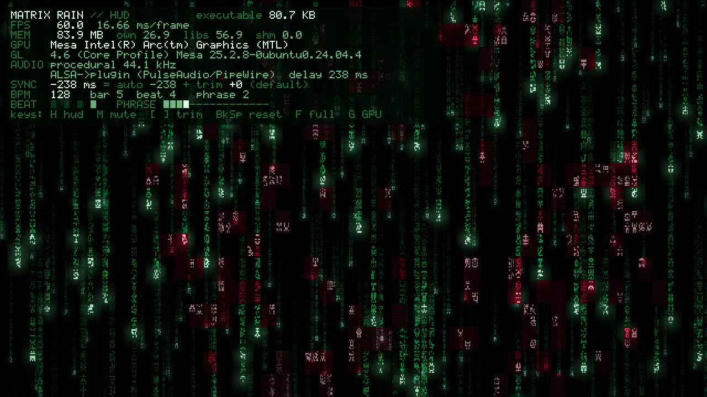

# MATRIX RAIN: a 4K-intro-style demo for Linux



*HUD on (`H`), a few beats after a phrase hit: the red virus is breaking up and the green code is taking back over.*

Falling green code, generated entirely in a GLSL fragment shader (plus a
small post-processing pass), synced to a 128 BPM techno loop that is
synthesised from scratch at startup. No textures, no fonts, no sample files:
just math.

The code is written to be **read**. Every file is commented for learning,
explaining the shader math, the timing, OpenGL setup on Linux, and audio.

## Download (no build needed)

**[⬇ Get the latest release](https://github.com/astralvoid2/matrixdemo1/releases/latest)**: a single ~75 KB executable for x86-64 Linux.

| File | Runs on |
|------|---------|
| `matrixrain-ubuntu22.04` | Ubuntu 22.04, 24.04 and newer (pick this one if unsure) |
| `matrixrain-ubuntu24.04` | Ubuntu 24.04 and newer |

```sh
sudo apt install libglfw3                # one-time: the windowing library
chmod +x matrixrain-ubuntu22.04
./matrixrain-ubuntu22.04                 # add --fullscreen, or press F
```

Each file was built in a clean container of that Ubuntu release. `SHA256SUMS`
on the release page lets you verify the download (`sha256sum -c SHA256SUMS`).
Other distros: build from source below (it takes seconds).

## Build & run (Ubuntu 22.04 / 24.04 or newer)

```sh
sudo apt install build-essential pkg-config libglfw3-dev libgl1-mesa-dev libasound2-dev
make
./bin/demo
```

| Package           | Why                                                   |
|-------------------|-------------------------------------------------------|
| build-essential   | gcc, make, ld                                         |
| pkg-config        | the Makefile asks it for GLFW's compiler/linker flags |
| libglfw3-dev      | window, OpenGL context, keyboard                      |
| libgl1-mesa-dev   | OpenGL headers + libGL (works with NVIDIA drivers too) |
| libasound2-dev    | ALSA sound output (routed through PipeWire/PulseAudio) |

The result is a single executable, `bin/demo`. The shader source is embedded
inside it, so it can be copied anywhere.

### Controls

| Key          | Action                                                     |
|--------------|------------------------------------------------------------|
| `ESC` / `Q`  | quit                                                       |
| `F` / `F11`  | toggle fullscreen                                          |
| `M`          | mute / unmute (visual sync keeps running)                  |
| `R`          | hot-reload `src/shader.frag` and `src/post.frag` (run from the repo root) |
| `H`          | toggle the HUD: executable size, FPS, GPU time, memory, GPU, audio latency, sync, beat/phrase meters |
| `V`          | toggle vsync (off = unlocked frame rate, for benchmarking) |
| `S`          | render scale: cycle 100% / 75% / 50% (draw the scene smaller, stretch it to the screen) |
| `[` / `]`    | personal sync trim -/+ 10 ms on top of the automatic sync (hold to sweep). **Remembered** between runs |
| `Backspace`  | reset the trim to 0                                        |
| `G`          | relaunch on the other GPU (Intel/AMD and NVIDIA, see below) |

### Command-line options

```
./bin/demo --fullscreen          start fullscreen
./bin/demo --nosound             no audio (visuals use the wall clock)
./bin/demo --hud                 start with the HUD visible
./bin/demo --novsync             unlocked frame rate (benchmark)
./bin/demo --scale 50            render the scene at 50% resolution (faster on 4K screens)
./bin/demo --sync-ms 30          trim: visuals 30 ms later (overrides the remembered trim)
./bin/demo --wav track.wav --bpm 140 [--offset 0.25]   play your own track
./bin/demo --export track.wav    save the built-in music as a WAV and exit
make track                       same as above, writes ./track.wav
```

## Project layout

```
.
├── Makefile            build rules
├── README.md
├── LICENSE
├── docs/screenshot.png   README image
├── src/
│   ├── main.c          window, GL context, shaders, main loop, beat uniforms
│   ├── shader.frag     pass 1: the Matrix rain scene (embedded at build time)
│   ├── post.frag       pass 2: RGB split, vignette, scanlines, grain, tone mapping
│   ├── synth.c/.h      procedural music (BPM is defined in synth.h)
│   ├── hud.c/.h        text overlay (H): bitmap font, CPU canvas, blend pass
│   └── audio.c/.h      ALSA playback thread, music clock, WAV load/save
├── build/              object files      (generated by make, not committed)
└── bin/demo            the executable    (generated by make, not committed)
```

| File               | What's inside                                                         |
|--------------------|-----------------------------------------------------------------------|
| `src/main.c`       | GLFW window, GL 3.3 core context, shader build/reload, the full-screen triangle, music clock and beat uniforms, main loop, fullscreen toggle |
| `src/shader.frag`  | Pass 1, the scene: integer hashes, stateless drop/reset logic, procedural 5x7 glyphs, glow, beat hits, virus, glitch. Renders into an HDR texture |
| `src/post.frag`    | Pass 2, screen-space effects: RGB split, vignette, scanlines, film grain, tone mapping |
| `src/synth.c/.h`   | Procedural music: kick, clap, hats, rolling bass, pad, arp + delay, sidechain pumping |
| `src/audio.c/.h`   | ALSA playback thread, latency-corrected music clock, WAV loader/writer |
| `src/hud.c/.h`     | HUD overlay: 5x7 bitmap font drawn into a texture, composited with a second tiny shader |
| `Makefile`         | Build rules, including embedding `shader.frag` with `ld -r -b binary` |

## The music and sync

* **Tempo: 128 BPM, 4/4.** Kick on every beat starting at t = 0.
  1 beat = 0.46875 s, 1 bar = 1.875 s, loop = 8 bars = **15.0 s**.
* Progression in A minor, one chord per bar: `Am Am F G | Am Am F E`.
  The arpeggio only plays in bars 5–8, and the last beat drops the kick for a
  clap roll.
* Sync needs no audio analysis. Because the BPM is known,
  `beats = seconds * BPM / 60`, and the fractional part of that is where we
  are inside the current beat. The shader receives:
  * `uBeat`: `exp(-5 * fract(beats))`, 1.0 on each kick and decaying fast
  * `uBeatCount`: beats elapsed. The shader derives the musical hierarchy
    from it, and bigger musical units get bigger hits:

    | Every            | Visual event                                                    |
    |------------------|-----------------------------------------------------------------|
    | beat (kick)      | heads flare, haze breathes, rain surges forward                 |
    | bar (4 beats)    | zoom punch + RGB split                                          |
    | phrase (16 beats)| tear glitch as build-up, then flash + shake + **virus outbreak**: red corruption spreads from a random point, fills the gaps with corrupted glyphs, cuts glitch-window insets, then breaks up block by block |
  * `uRainTime`: a time that runs faster just after each kick. It is
    *integrated* (`rain += dt * speed`), not `time * speed`, so the rain
    never jumps.
* "Seconds" here is **audio time**, counted in samples played rather than
  wall-clock time, so the visuals cannot drift from the music, even after
  hours. Exactly which point in the audio chain to lock to is the next
  section.

### Sync: which point in the audio chain the visuals follow

`snd_pcm_delay()` reports how much audio is queued between the demo and the
output: about **70 ms** on the laptop speakers here, and about **240 ms** on
Bluetooth headphones. In theory you subtract it ("you hear this sample
*delay* seconds from now"). In practice, tested by ear on both outputs, the
best sync was the opposite: visuals locked to the moment audio is handed to
ALSA, i.e. *not* subtracting the delay. The visual side has latency of its
own (compositor, display scan-out), and a fading flash is perceived around
the middle of its glow rather than at its start.

So the visual clock is:

```
visual time = heard-time estimate + smoothed ALSA delay - your trim
```

* **Automatic part:** follows the reported delay live (smoothed over about
  half a second), so switching between speakers and Bluetooth just works,
  even mid-run.
* **Trim:** your personal preference on top, default 0. `[` / `]` adjust it in
  10 ms steps (positive = visuals later). It's saved to
  `~/.config/matrixrain/sync_trim_ms` (or under `$XDG_CONFIG_HOME`) and used
  on the next start. `Backspace` resets it, and `--sync-ms N` overrides it.
* The HUD shows the total and both parts, e.g. `SYNC -236 ms = auto -236 + trim +0 (default)`.

*Lesson learned:* an earlier version measured sync by recording the screen and
the speaker monitor with ffmpeg, and "corrected" by +110 ms. But ffmpeg's
PulseAudio capture timestamps audio using the same latency reports, which
PipeWire leaves at 0 µs, so the instrument shared the blind spot it was
measuring. When the tool and your ears disagree, check the tool.

### Frame rate, vsync and GPU time (the HUD's FPS line)

By default the demo waits for the display's refresh before showing each frame
(**vsync**), so FPS sits at your refresh rate, e.g. 60. That's deliberate:
a 60 Hz panel can't show more frames, rendering them anyway causes
**tearing** (a frame replaced mid-scan) and burns power, heat and fan noise
for nothing, and every frame staying on screen for exactly one refresh looks
smoothest.

The cost: a locked counter can't show **headroom**. So the HUD also shows
**GPU time**, measured by the GPU itself with OpenGL timer queries
(`GL_TIME_ELAPSED`, read back a few frames later so it never stalls): the
smoothed average plus the **peak** (worst frame in the last second). At 60 Hz
the budget is 16.7 ms. `V` (or `--novsync`) unlocks the frame rate to
benchmark.

### Two passes: why the scene goes through a texture

The first version drew everything in one shader. The **RGB split** (red and
blue pulled sideways on bar punches and virus hits) needs the scene at three
positions, and in one pass the only way to get that is to **render the whole
scene three times**. At 3840×2400 on the Intel Arc, that pushed the worst
frames to 17–19 ms, over the 16.7 ms budget, so it dropped frames once per bar.

Now the work is split:

1. **Scene pass** (`shader.frag`): draws the rain **once** into an off-screen
   **framebuffer object** (FBO) whose colour is a `GL_RGBA16F` texture. 16-bit
   float, because glow values above 1.0 must survive until tone mapping.
2. **Post pass** (`post.frag`): draws the window by reading that texture. The
   RGB split is now three texture reads, not three scenes. Vignette,
   scanlines, grain and tone mapping happen here too, at full display
   resolution.

The texture also enables a **render scale** (`S`, `--scale`): the scene can be
drawn at 75% or 50% size and stretched by bilinear filtering in the post pass.
Because scanlines and grain are still added per display pixel, the stretch is
hard to notice.

Measured fullscreen at 3840×2400:

| | GPU avg | GPU peak | FPS (vsync) | FPS (unlocked) |
|---|---|---|---|---|
| Intel Arc, one-pass (before) | 6–14 ms | 17–19 ms | **48–60** | 56–73 |
| Intel Arc, two-pass, 100% | 8.3 ms | **10.9 ms** | **60** | 66–68 |
| Intel Arc, two-pass, 75% | 5.7 ms | 8.3 ms | 60 | 80–82 |
| Intel Arc, two-pass, 50% | 4.0 ms | 6.4 ms | 60 | 95–96 |
| NVIDIA RTX 2000 Ada, two-pass, 100% | 2.7 ms | 2.7 ms | 60 | 158–163 |

Unlocked FPS sits below what GPU time alone would allow: presenting a
3840×2400 frame (the compositor and display copy) costs time outside the
demo's own draw calls. That's why windowed is much faster.

### How big is it? (the HUD's MEM line)

The HUD's title line shows the **executable size** (about 80 KB here,
uncompressed and not size-optimized: everything, including the synth and
shaders, is in there). The `MEM` line reads `/proc/self/status` once a
second:

| Field | Meaning | Typical |
|-------|---------|---------|
| total (`VmRSS`) | everything resident in RAM | ~80–85 MB |
| `own` (`RssAnon`) | private memory: the 2.6 MB music loop, heaps, GL driver allocations | ~27 MB |
| `libs` (`RssFile`) | shared-library pages: libGL, the Mesa/NVIDIA driver, libc… | ~55 MB |
| `shm` (`RssShmem`) | shared memory buffers | ~0 MB |

So a tiny program pulls in a large driver: almost all of the footprint is
the OpenGL stack, not the demo. Real 4K intros have the same runtime cost,
since "4K" limits the *file*, not RAM. VRAM on the NVIDIA GPU isn't in these
numbers (it's not system RAM).

### Replacing the music with your own track (e.g. from a music-generation model)

1. Generate or export a track. The ideal shape is a seamless loop at a
   **constant tempo**. Note the BPM the model was asked for (e.g. "128 BPM
   techno, loopable").
2. Convert it to a format the loader understands: 16-bit PCM or 32-bit float
   WAV, mono or stereo, any sample rate. `ffmpeg` handles OGG/MP3/FLAC:
   ```sh
   sudo apt install ffmpeg
   ffmpeg -i generated.mp3 -ac 2 -ar 44100 -sample_fmt s16 track.wav
   ```
3. Run it, telling the demo the tempo, and the time of the first downbeat if
   the track doesn't start exactly on a beat:
   ```sh
   ./bin/demo --wav track.wav --bpm 128 --offset 0.0
   ```
   Tune `--offset` until the green flashes land on the kicks. A positive
   offset delays the visual beat.
4. To make it the default, change `DEMO_BPM` in `synth.h`, and in `main()`
   either hard-code the path passed to `audio_start_wav()` or embed the WAV
   just like the shader (`ld -r -b binary track.wav`).

`./bin/demo --export ref.wav` gives you the built-in loop as a WAV, handy as a
style or tempo reference when prompting a music model.

## Sharing the binary

Ready-made builds are on the [Releases page](https://github.com/astralvoid2/matrixdemo1/releases/latest)
(see [Download](#download-no-build-needed)). This section explains what a
binary needs, if you build and share your own.

`bin/demo` isn't fully self-contained. It loads these shared libraries at
startup (`objdump -p bin/demo | grep NEEDED`):

| Library | Ubuntu package (runtime, not `-dev`) | On a normal desktop? |
|---------|--------------------------------------|----------------------|
| `libglfw.so.3`   | `libglfw3`       | **usually not**, install it |
| `libGL.so.1`     | `libgl1`         | yes                         |
| `libasound.so.2` | `libasound2t64`  | yes                         |
| `libc`, `libm`   | `libc6`          | yes                         |

So on another **Ubuntu 24.04 (or newer) x86-64 desktop**, the recipient needs:

```sh
sudo apt install libglfw3
./demo
```

(Checked in a clean `ubuntu:24.04` container: before installing the libraries,
`ldd` reports GLFW, GL and ALSA as missing; after installing them, nothing is.)

**Older systems won't run it.** Built on 24.04, it requires **glibc 2.38**
(`objdump -T bin/demo | grep GLIBC_2.3`), e.g. for `fmod` and the C23
`sscanf`. Ubuntu 22.04 ships glibc 2.35 and fails with
`GLIBC_2.38 not found`. glibc is backward compatible, not forward, so to
support older distros, **build on the oldest one you want to support**
(e.g. inside an `ubuntu:22.04` container). Other distros (Fedora, Arch…) work
if their glibc is new enough and they have GLFW installed. Different CPU
architectures (ARM) need a rebuild.

The most portable option is still the source: `git clone` + `make` takes
seconds. For sharing a ready-made binary, attach it to a GitHub Release
together with the one-line `apt install` above.

## GPU selection (hybrid laptops), drivers and display servers

The demo uses plain OpenGL 3.3 core, which every Intel, AMD and NVIDIA GPU
from roughly 2010 onwards supports. At startup it prints `GL_RENDERER`, so you
can see which GPU you got. The HUD (`H`) shows it too.

**Press `G` to switch GPUs.** A GL context can't move between GPUs, so the
demo sets the PRIME offload variables below and `exec()`s itself. It
restarts on the other GPU with your HUD, fullscreen and sync settings intact,
and the music restarts. If the NVIDIA context can't be created, it says why and
falls back to the integrated GPU.

* **NVIDIA dGPU + Intel/AMD iGPU (proprietary driver, PRIME offload):**
  ```sh
  prime-run ./bin/demo                          # if nvidia-prime provides it
  __NV_PRIME_RENDER_OFFLOAD=1 __GLX_VENDOR_LIBRARY_NAME=nvidia ./bin/demo   # equivalent
  ```
* **AMD/Intel dGPU, or NVIDIA with the open-source nouveau driver (Mesa):**
  ```sh
  DRI_PRIME=1 ./bin/demo
  ```
* `sudo prime-select nvidia|intel|on-demand` switches the default
  system-wide on Ubuntu (needs a logout).
* Check your GL version with `glxinfo -B` (`sudo apt install mesa-utils`).
* **Wayland:** Ubuntu's GLFW 3.3 runs through XWayland, which works fine. No
  action needed.
* **Vsync:** the demo requests it (`glfwSwapInterval(1)`). If you see
  hundreds of fps in the title bar, the driver is overriding it; try
  `vblank_mode=1 ./bin/demo` (Mesa) or the NVIDIA settings panel.

## Troubleshooting

* `G` / `prime-run` fails with `GLX: Failed to create context: BadValue` →
  run `nvidia-smi`. If it says **"Driver/library version mismatch"**, the
  NVIDIA driver was updated but the old one is still loaded. **Reboot.**

* `Package glfw3 was not found` → install `libglfw3-dev` and `pkg-config`.
* `Could not create an OpenGL 3.3 core window` → you are probably in a VM or
  over SSH without GPU acceleration. Run it on the desktop session.
* `audio: cannot open ALSA 'default' device` → the demo continues silently.
  Check that `aplay /usr/share/sounds/alsa/Front_Center.wav` works.
  On a PipeWire system without the ALSA plugin: `sudo apt install pipewire-alsa`.
* Shader edits: run from the project directory, press `R`, and read the
  terminal for compile errors (the old shader keeps running). Run `make` to
  bake your changes into the binary.

## Learning notes: where to look

| Topic                                          | Where                                          |
|------------------------------------------------|------------------------------------------------|
| Why one full-screen triangle, not a quad       | top of `main.c`, and `VERTEX_SRC`              |
| Core profile, GLFW hints, GL function loading on Linux | top of `main.c`, window setup in `main()` |
| How time/resolution/beat reach the shader      | `main()` main loop (uniforms), shader header   |
| Integer hash vs `fract(sin())`                 | `shader.frag`, HASHING section                 |
| Column speed & stateless reset (`mod` + `iter`) | `shader.frag`, `getDrop()`                    |
| Procedural glyphs                              | `shader.frag`, `glyph()`                       |
| Cheap bloom (Gaussian glow over neighbour columns) | `shader.frag`, `rainLayer()`               |
| Beat hierarchy, virus spread/heal, RGB split   | `shader.frag`, `infection()`, `scene()`, `main()` |
| Integrating speed instead of `time * speed`    | `main.c`, RAIN TIME comment                    |
| Audio latency & the music clock                | `audio.c`, `audio_thread()` and `audio_time()` |
| Audio/visual sync: auto delay + trim           | `audio.c` `audio_smoothed_delay()`, `main.c` SYNC + MASTER CLOCK |
| Reading your own memory use from `/proc`       | `main.c`, `read_memory()`                      |
| Vsync, and timing the GPU with timer queries   | `main.c`, VSYNC and TIMER QUERIES comments     |
| Render-to-texture (FBO), two passes, render scale | `main.c` RENDER TARGET, `post.frag` header  |
| Saving settings the Linux way (XDG config dir) | `main.c`, `sync_file_path()`                   |
| Bitmap-font HUD, blending a second pass        | `hud.c`                                        |
| Switching GPU by re-exec'ing with PRIME variables | `main.c`, `relaunch_on_other_gpu()`         |
| Kick/clap/hat/bass synthesis, SVF filter, sidechain | `synth.c`                                 |
| Embedding files in an executable               | `Makefile`, `shader_frag.o` rule               |

### Ideas to try

* Change `TRAIL_COLOR` to amber or cyan for a different cyberpunk palette.
* Make `uBeat` scale the glyph mutation rate, so characters scramble on kicks.
* Add a third, even closer layer with a few huge, blurry glyphs.
* Make the bass pattern in `synth.c` change every 4 bars.
* Size-code: strip the comments and pack the binary with `strip` + `upx`
  to see how close to a real 4K you can get.

## License

MIT. See [LICENSE](LICENSE). Use it, learn from it, remix it into your own intro.
